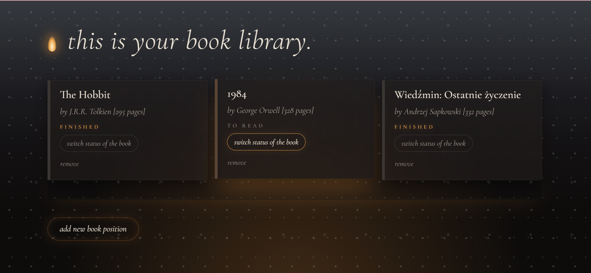
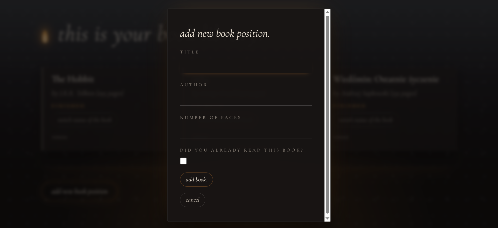

# Book Shelf

A small library app for keeping track of the books you want to read and the ones you've already finished, built with vanilla JavaScript as part of [The Odin Project](https://www.theodinproject.com/) curriculum.

**Live demo:** [ala0702.github.io/book-shelf](https://ala0702.github.io/book-shelf/)




## Features

- Add a new book through a form in a modal dialog (title, author, number of pages, read status)
- Remove a book from the library
- Toggle a book's status between "to read" and "finished"
- Books are displayed as cards in a responsive grid that adapts to the screen width

## How it works

All books live in a single array, which is the only source of truth. The page never stores data on its own: every action first updates the array, then the whole collection is re-rendered from it.

```
user action  →  update the data (array)  →  displayBooks() re-renders the page
```

- `Book` is an object constructor; each book gets a unique `id` from `crypto.randomUUID()`
- `toggleIsDone()` lives on `Book.prototype`, because changing its status is something a single book does to itself
- `createBook()` and `deleteBook()` are separate functions, because adding and removing books changes the library, not the book
- each card's buttons know which book they belong to through a `data-id` attribute

## Built with

- HTML
- CSS
- JavaScript (no frameworks or libraries)

## What I learned

I wrote all of the JavaScript logic myself. Along the way I learned:

- **Object constructors and prototypes**: creating objects with `new`, what `new` actually does, and why shared methods belong on the prototype instead of being copied into every object
- **How `this` works**: why it depends on how a function is called, and why arrow functions don't have their own `this`.
- **Separating data from display**: keeping the data in an array and re-rendering the view from it, instead of storing information in the HTML.
- **DOM manipulation**: building elements with `createElement` and filling them with `textContent`, and why `innerHTML` with user input can open the door to XSS attacks
- **Events and forms**: listening for `submit` on the form instead of `click` on the button, and using `event.preventDefault()` to stop the page from reloading
- **The `<dialog>` element** for a modal form with built-in keyboard and accessibility support.

## A note on the styling

The focus of this project was JavaScript, so the CSS was generated with the help of an AI assistant, based on the mood I described. I made the design decisions and reviewed the code to understand how it works, for example the responsive grid with `repeat(auto-fit, minmax(240px, 1fr))`, styling state through a class toggled from JavaScript (`.book-status.done`), and the `::backdrop` of the dialog. The JavaScript and HTML structure are my own work.

## Credits

Font: [Cormorant Garamond](https://fonts.google.com/specimen/Cormorant+Garamond) from Google Fonts.